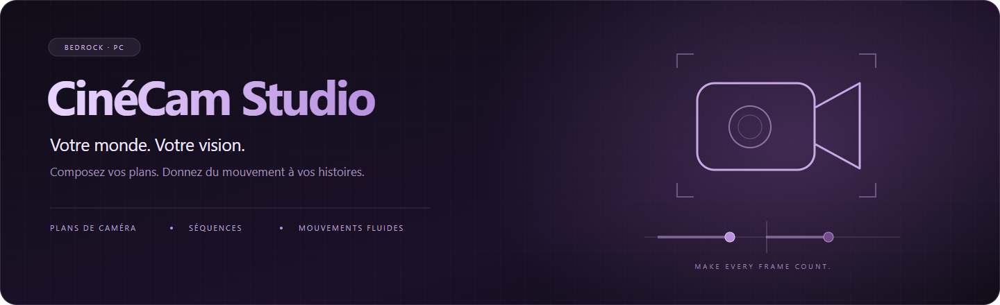
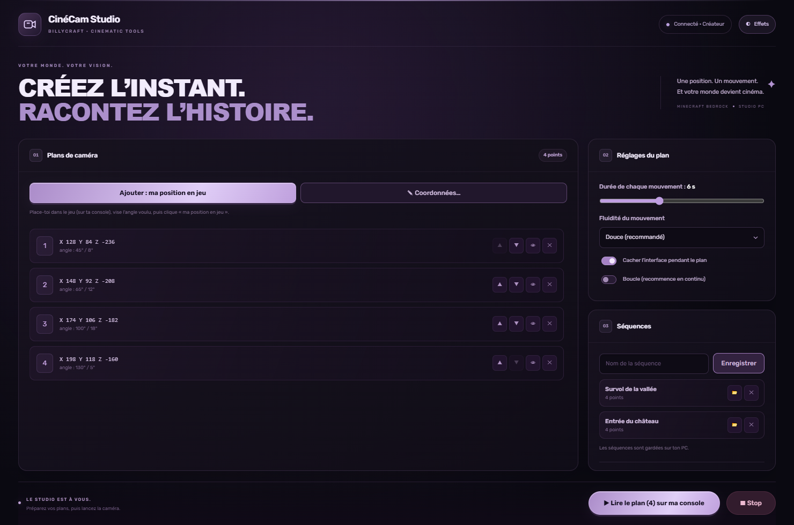
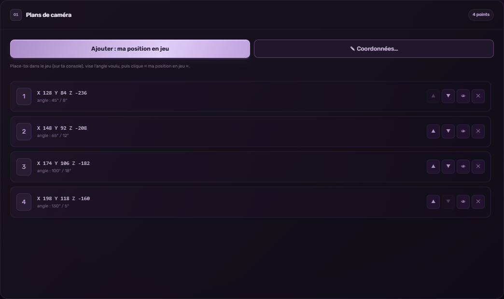
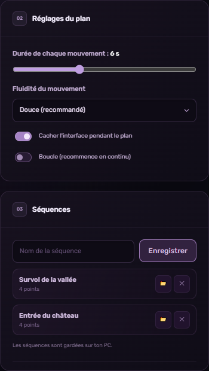
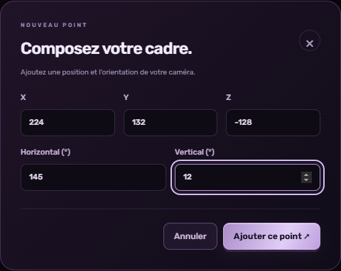

<div align="center">



### Vos constructions méritent leur scène d’ouverture.

Préparez vos cadrages, composez vos mouvements et transformez<br>
votre univers **Minecraft Bedrock** en terrain de cinéma.

**Windows** &nbsp; · &nbsp; **Go 1.24+** &nbsp; · &nbsp; **Interface en français** &nbsp; · &nbsp; **Noir & lavande**

[Découvrir](#decouvrir) &nbsp; / &nbsp; [Aperçus](#apercus) &nbsp; / &nbsp; [Démarrer](#demarrer) &nbsp; / &nbsp; [Configurer](#configuration) &nbsp; / &nbsp; [FAQ](#faq)

</div>

---

<a id="decouvrir"></a>

## Un studio sur votre PC. L’action dans votre monde.

**CinéCam Studio** est une application de préparation et de pilotage de caméra pour Minecraft Bedrock. Placez-vous en jeu, récupérez vos coordonnées, organisez vos points et choisissez le mouvement qui raconte votre histoire.

Une interface sombre, des accents lavande et des commandes regroupées en trois espaces : **plans**, **réglages** et **séquences**.

> [!IMPORTANT]
> Ce dépôt contient le **client PC**. Les commandes en jeu nécessitent votre propre **pont HTTP CinéCam** et le comportement de caméra correspondant sur le serveur Bedrock. Le pont serveur et le pack Minecraft ne sont pas inclus. L’application n’enregistre pas de vidéo : la capture se fait avec les outils de votre console ou de votre PC.

<a id="apercus"></a>

## Entrez dans le studio



<p align="center"><sub>Une timeline à gauche. Vos réglages et séquences à droite. La lecture à portée de main.</sub></p>

### Chaque plan commence par un cadre.

| Composez votre trajectoire | Retrouvez vos séquences |
| :---: | :---: |
|  |  |
| Ajoutez, réordonnez et prévisualisez vos points. | Réglez le mouvement et enregistrez vos idées. |

### Le bon angle, au bon endroit.

<p align="center">
  
</p>

<p align="center"><sub>Captures de l’interface réelle avec des données de démonstration. Aucun serveur de jeu n’a été contacté pour les réaliser.</sub></p>

## Ce que vous pouvez créer

| Outil | Ce qu’il vous apporte |
| :--- | :--- |
| **Capture de position** | Récupérez la position et l’orientation de votre joueur via le pont CinéCam. |
| **Coordonnées manuelles** | Saisissez X, Y, Z ainsi que les angles horizontal et vertical. |
| **Timeline de points** | Montez, descendez, supprimez un point ou placez la caméra dessus. |
| **Mouvements réglables** | Choisissez une durée de 1 à 15 secondes et l’une des quatre fluidités proposées. |
| **HUD & boucle** | Demandez le masquage de l’interface ou une lecture en continu. |
| **Séquences locales** | Nommez, enregistrez et rechargez vos points avec leurs réglages. |
| **Commande de caméra** | Lancez un mouvement, arrêtez-le ou demandez l’objet de caméra en jeu. |
| **Mode sans animations** | Réduisez les effets visuels du studio avec le bouton **Effets**. |

<a id="demarrer"></a>

## Votre première prise, en quatre étapes

### 01 — Compilez l’application

Vous avez besoin de **Windows**, de **Go 1.24 ou supérieur** pour compiler, et de **Microsoft Edge ou Google Chrome** pour ouvrir l’interface.

Depuis le dossier contenant `go.mod` :

```powershell
go build -trimpath -ldflags "-s -w -H=windowsgui" -o CineCamStudio.exe .
```

L’interface, les polices et les images sont intégrées au fichier `.exe`. Après compilation, l’utilisateur n’a pas besoin d’installer Go ou Node.js pour l’exécuter.

### 02 — Reliez votre monde

Copiez le modèle de configuration :

```powershell
Copy-Item cinecam.example.json cinecam.local.json
```

Dans `cinecam.local.json`, remplacez l’adresse d’exemple par **celle de votre propre pont CinéCam** :

```json
{
  "apiBase": "https://example.com/votre-pont-cinecam/"
}
```

Placez ce fichier **à côté de `CineCamStudio.exe`**, puis lancez l’application :

```powershell
.\CineCamStudio.exe
```

### 03 — Composez votre mouvement

1. Connectez votre joueur au serveur Minecraft configuré.
2. Placez-vous au premier cadrage, puis cliquez sur **Ajouter : ma position en jeu**. Vous pouvez aussi utiliser **Coordonnées…**.
3. Ajoutez les points suivants et réorganisez-les dans la timeline.
4. Réglez la durée, la fluidité, le HUD et la boucle.
5. Donnez un nom à la séquence, puis cliquez sur **Enregistrer**.

### 04 — Action !

Cliquez sur **Lire le plan sur ma console** pour envoyer la séquence au pont CinéCam. Lancez votre capture vidéo avec les outils de votre appareil. Le bouton **Stop** interrompt la caméra.

> [!TIP]
> Commencez avec quelques points, un mouvement doux et une durée courte. Prévisualisez les cadrages avant de lancer une longue séquence.

<a id="configuration"></a>

## Une connexion qui reste la vôtre

L’adresse du pont est lue au démarrage, selon cet ordre :

| Priorité | Configuration |
| :---: | :--- |
| **1** | Variable d’environnement `CINECAM_API_BASE` |
| **2** | Fichier `cinecam.local.json` situé à côté de l’exécutable |

Exemple avec PowerShell :

```powershell
$env:CINECAM_API_BASE = "https://example.com/votre-pont-cinecam/"
.\CineCamStudio.exe
```

L’adresse doit être une URL HTTP ou HTTPS valide, sans paramètres de requête ni fragment. Utilisez HTTPS pour un pont accessible sur Internet.

Le client sert son interface uniquement sur **`127.0.0.1:47931`**. Le navigateur parle au serveur local Go, qui relaie les commandes vers votre pont :

```text
┌─────────────────────┐     ┌─────────────────────┐     ┌────────────────────┐
│ Interface du studio │ ──▶ │ Serveur Go local    │ ──▶ │ Votre pont CinéCam │
│ Edge / Chrome       │     │ 127.0.0.1:47931     │     │ Minecraft Bedrock  │
└─────────────────────┘     └─────────────────────┘     └────────────────────┘
```

### Contrat du pont HTTP

Le pont doit proposer les routes ci-dessous, avec les réponses JSON attendues par `web/index.html`.

| Route | Méthode | Rôle |
| :--- | :---: | :--- |
| `players` | `GET` | Retourner les joueurs : `{ "players": ["NomDuJoueur"] }`. |
| `where?player=NomDuJoueur` | `GET` | Retourner une position avec `x`, `y`, `z`, `ry` et `rx`. |
| `tool` | `POST` | Recevoir `{ "player": "NomDuJoueur" }` et fournir l’objet de caméra. |
| `play` | `POST` | Recevoir `player`, `points` et les réglages `cfg`. |
| `stop` | `POST` | Recevoir `{ "player": "NomDuJoueur" }` et arrêter la caméra. |

Les réglages `cfg` comprennent `dur`, `easeIdx`, `hud` et `loop`. Le mode de protection du pont doit être compatible avec ce client ; aucune connexion à un serveur partagé n’est fournie.

> [!WARNING]
> Une adresse de pont peut contenir un accès privé. Gardez-la dans votre configuration locale. `cinecam.local.json`, les secrets et les exécutables sont exclus de Git par le `.gitignore`.

<a id="faq"></a>

## Les réponses avant la première prise

<details>
<summary><strong>Est-ce compatible avec Minecraft Java Edition ?</strong></summary>

Ce client est conçu pour une intégration CinéCam avec **Minecraft Bedrock**. Il ne fournit pas de mod Java Edition.

</details>

<details>
<summary><strong>Pourquoi le studio indique-t-il « Serveur injoignable » ?</strong></summary>

Vérifiez l’adresse de votre pont, sa disponibilité et votre connexion réseau. Si vous utilisez le fichier de configuration, il doit être à côté de l’exécutable et contenir un JSON valide. Relancez ensuite le studio. Sans pont configuré, vous pouvez préparer des points manuels et enregistrer des séquences, mais les commandes en jeu restent indisponibles.

</details>

<details>
<summary><strong>Où sont enregistrées les séquences ?</strong></summary>

Dans le `localStorage` du profil de navigateur utilisé par l’application, sous la clé `cinecam.seqs`. Le profil de la fenêtre est situé dans `%APPDATA%\CineCamStudio\fenetre`. Supprimer ce profil ou ses données peut supprimer vos séquences. Cette version ne propose pas de bouton d’export des séquences.

</details>

<details>
<summary><strong>Le programme reste-t-il ouvert après la fermeture de la fenêtre ?</strong></summary>

Il vérifie régulièrement l’activité de l’interface et s’arrête après environ **90 secondes sans heartbeat**, avec un contrôle toutes les 20 secondes. Si le port est déjà occupé, un nouveau lancement tente d’ouvrir l’interface existante. Attendez la fin de l’ancien processus avant de tester un nouvel exécutable.

</details>

<details>
<summary><strong>Comment afficher les messages de diagnostic ?</strong></summary>

Compilez sans l’option qui masque la console, puis lancez l’exécutable depuis PowerShell :

```powershell
go build -o CineCamStudio.exe .
.\CineCamStudio.exe
```

</details>

<details>
<summary><strong>Est-ce que le studio filme ou monte mes vidéos ?</strong></summary>

Le studio prépare et pilote les mouvements de caméra. La capture vidéo, le son et le montage se font avec vos propres outils.

</details>

## Dans les coulisses

```text
CineCam-Studio/
├── main.go                  Serveur local et relais des commandes
├── config.go                Lecture de la configuration privée
├── sys_windows.go           Fenêtre d’application Edge / Chrome
├── sys_other.go             Variante pour les autres systèmes
├── cinecam.example.json     Modèle public de configuration
├── web/
│   ├── index.html           Interface et logique du studio
│   ├── studio.css           Thème noir et lavande
│   ├── fonts/               Polices embarquées
│   ├── icons/               Icônes de l’interface
│   └── assets/              Textures
└── docs/images/             Bannière et captures du README
```

Pour vérifier le projet avec Go :

```powershell
go test ./...
go vet ./...
```

### Une idée pour la prochaine version ?

Ouvrez une issue en décrivant votre besoin, ou les étapes pour reproduire un problème. Pour un bug de connexion, indiquez votre version de Windows et le message affiché, **sans joindre d’adresse secrète ni de configuration privée**.

## Licence & crédits

Aucune licence de redistribution du code n’a encore été choisie pour ce dépôt. Les polices, icônes et textures conservent les droits et conditions de leurs auteurs.

CinéCam Studio est un projet indépendant, non affilié à Mojang ou Microsoft. Minecraft appartient à ses ayants droit.

---

<div align="center">

**Une position. Un mouvement. Une histoire.**

<sub>CinéCam Studio · Votre monde devient cinéma.</sub>

</div>
